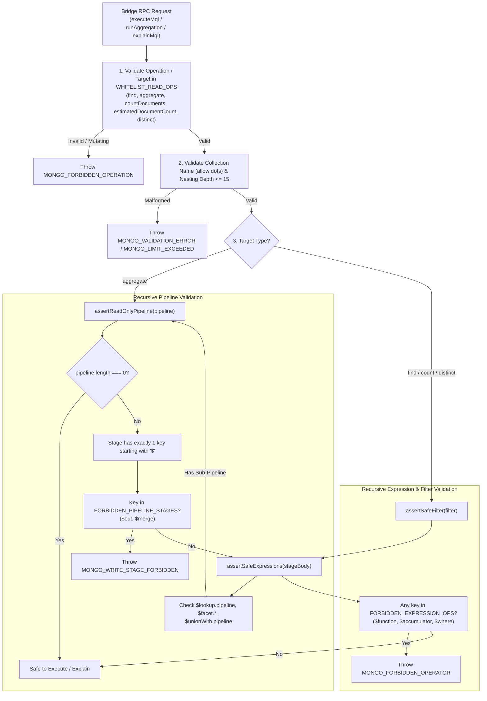

# MongoDB Milestone 5 (M5) — Query Workspace & Visual Aggregation Pipeline Builder Specification

- **Status:** Final Specification for Implementation
- **Milestone:** M5
- **Preceding Milestones:**
  - `CLAUDE_NOSQL_PROPOSAL.md` (Overarching Product Roadmap)
  - `docs/MONGODB_M1_SPEC.md` (Connector Foundation, committed `e303c3d`)
  - `docs/MONGODB_M2_SPEC.md` (Document Engine Backend, committed `6429f3b`)
  - `docs/MONGODB_M3_SPEC.md` (Read Experience & Schema Inference, committed `42612fb`)
  - `docs/MONGODB_M4_SPEC.md` (Mutation Experience, committed `8b8309d`)
- **Scope:** The complete **MongoDB MQL Query Workspace / Scratchpad** and the **Visual Aggregation Pipeline Builder** in RelWave.
- **Authoring Constraint Honored:** Specification and planning only. No application code modifications, package installations, or commits are made during this task.

---

## 1. Executive Summary & Current-State Analysis

Milestones 1 through 4 delivered the complete read/write lifecycle for MongoDB in RelWave:
- **M1:** Connection pooling, verbatim `mongodb+srv://` preservation, and BSON foundation.
- **M2:** Backend Document Engine implementing `findDocuments`, `insertDocument`, `updateDocument`, `replaceDocument`, `deleteDocument`, and `runAggregation`.
- **M3:** Desktop read experience with statistical schema inference, paginated document viewing, and EJSON filter input.
- **M4:** Desktop mutation dialogs (schema-guided insert, patch/replace edit, destructive delete), collection lifecycle management, and recursive diff engine.

**Milestone 5 (M5)** provides rich analytical query capabilities for MongoDB developers through two distinct, complementary features:
1. **MongoDB MQL Query Workspace / Scratchpad:** A dedicated, code-first query environment for writing, testing, explaining, and executing MongoDB queries with a CodeMirror JSON/MQL editor, a hybrid mongosh parser, and dual-mode result viewers (interactive Collapsible JSON Tree and tabular Document View).
2. **Visual Aggregation Pipeline Builder:** A visual canvas for constructing, reordering, validating, and testing multi-stage aggregation pipelines with guided stage forms, live intermediate stage preview, and direct export to MQL scripts.

```
┌────────────────────────────────────────────────────────────────────────────────────────┐
│ RelWave Desktop Client (M5 Architecture)                                               │
│                                                                                        │
│  Navigation                  MQL Query Workspace          Aggregation Pipeline Builder │
│  ┌────────────────────────┐  ┌──────────────────────────┐  ┌─────────────────────────┐ │
│  │ [Layers] Data View     │  │ [Collection] [Op: find ▼]│  │ Pipeline Stages (users) │ │
│  │ [Term]   MQL Workspace │  │ ┌──────────────────────┐ │  │ ├─ 1. $match        [▼] │ │
│  │ [Search] Agg Builder   │  │ │ db.users.find({ ... })│ │  │ ├─ 2. $lookup       [▼] │ │
│  │ ────────────────────── │  │ └──────────────────────┘ │  │ ├─ 3. $group        [▼] │ │
│  │ [Hist]   Migrations    │  │ [Run (Ctrl+Enter)] [Exp] │  │ [+] Add Stage           │ │
│  │ [Git]    Git Status    │  │ ──────────────────────── │  │ ─────────────────────── │ │
│  └────────────────────────┘  │ Results: [Tree] [Table]  │  │ Live MQL Preview [Run]  │ │
│                              └──────────────────────────┘  └─────────────────────────┘ │
└───────────────────────────────────────────┬────────────────────────────────────────────┘
                                            │ JSON-RPC 2.0 (stdin/stdout)
                                            ▼
┌────────────────────────────────────────────────────────────────────────────────────────┐
│ RelWave Bridge (Node.js)                                                               │
│                                                                                        │
│  query.executeMql │ query.runAggregation │ query.explainMql                            │
│                                                                                        │
│  - Strict Bridge-Side Read-Only & Expression Validation (AST & Sub-Pipeline Recursion) │
│  - Identical Validation Applied to query.executeMql, runAggregation, and explainMql    │
│  - Whitelist Operation Dispatch (find, aggregate, countDocuments, distinct)            │
│  - Guardrails: FORBIDDEN_STAGES ($out, $merge), FORBIDDEN_OPS ($function, $acc, $where)│
│  - Resource Bounds: Hard Timeouts (maxTimeMS <= 60000ms), Document Cap (1000 docs)    │
│  - Canonical Page Limits: DEFAULT_PAGE_SIZE = 50, MAX_PAGE_SIZE = 100 (Clamped)        │
│  - Dots Permitted in Existing Collection Names (e.g. audit.events)                      │
│  - Round-trip BSON / EJSON v2 Serialization                                            │
└────────────────────────────────────────────────────────────────────────────────────────┘
```

### Current Codebase Facts vs. Proposed M5 Additions

| Component | Verified Current Codebase State | Proposed Milestone 5 State |
|---|---|---|
| **Bridge Aggregation** | `query.runAggregation` exists in `bridge/src/connectors/mongo.ts`, enforces `MAX_AGG_STAGES = 20`, rejects top-level `$out`/`$merge`. | Extend `validatePipeline` to support empty pipelines `aggregate([])`, recursively inspect sub-pipelines (`$lookup`, `$facet`, `$unionWith`), and recursively reject forbidden expression operators (`$function`, `$accumulator`, `$where`). |
| **Bridge Query Execution** | `query.findDocuments` exists; no general-purpose MQL query or explain RPC method. | Add typed `query.executeMql` (discriminated union) and `query.explainMql` to bridge and frontend services with strict runtime validation. |
| **Bridge Explain Plan** | `explainQuery` exists for SQL only (`EXPLAIN (ANALYZE, BUFFERS)`). | Add `query.explainMql` covering both `find` and `aggregate` with verbosity support and identical read-only security validation. |
| **Collection Validation** | `assertCollectionName` currently checks non-empty and rejected `.`; `assertNewCollectionName` in M4 enforces strict alphanumeric `^[a-zA-Z_][a-zA-Z0-9_-]*$`. | Reconcile `assertCollectionName` for existing collections to allow dots (`audit.events`), numbers, and spaces while enforcing length <= 120, no `\0`, no `$`, and no `system.*`. |
| **Frontend Code Editor** | `SqlEditor.tsx` uses `@codemirror/lang-sql`. `@codemirror/lang-json` is **not installed**. | Install `@codemirror/lang-json`; build `MongoMqlEditor.tsx` with JSON highlighting and MongoDB operator autocomplete. |
| **Navigation & Routing** | `VerticalIconBar.tsx` suppresses Workspace and Query Builder for `nosql`. `DatabaseDetails.tsx` hard-routes `isNosql` to `MongoDataViewPanel`. | Add `mongo-workspace` and `mongo-aggregation` to `PanelType`; route to dedicated MongoDB panels in `DatabaseDetails.tsx`. |
| **Result Presentation** | RelWave has `DataTable.tsx` and `MongoDocumentCell.tsx` for flat/tabular rendering. | Add `MongoTreeViewer.tsx` for collapsible hierarchical inspection with color-coded BSON type badges. |
| **Query History** | SQL workspace stores raw query history in localStorage. | Implement connection-isolated MQL history (`relwave_mql_history_${dbId}`) storing templated metadata with literal value redaction by default (zero document data/credentials). |
| **Query Cancellation** | Internal timeout cancellation via `AbortSignal` in `withMongoTimeout`. | Client-initiated cancellation across JSON-RPC is **strictly deferred** beyond M5; rely on `maxTimeMS` and bridge deadlines. |

---

## 2. Scope and Non-Goals

### 2.1 In Scope for Milestone 5
1. **MQL Query Workspace / Scratchpad:**
   - Tabbed scratchpad interface with collection picker and operation selector.
   - CodeMirror 6 JSON editor with autocomplete for query operators (`$gt`, `$in`, `$match`, etc.).
   - Frontend hybrid mongosh parser supporting standard `db.<coll>.<op>(...)` syntax with client-side syntax, constructor pre-validation, and compound statement rejection.
   - Typed bridge execution for `find`, `aggregate` (including `aggregate([])`), `countDocuments`, `estimatedDocumentCount` (payload optional/undefined), and `distinct`.
   - Dual-view result presentation: Interactive Collapsible Tree View and Virtualized Table View.
   - Execution plan explanation (`query.explainMql`) with index utilization and scanned-vs-returned metrics.
   - Local query history drawer (metadata with literal redaction, capped at 50 items).
2. **Visual Aggregation Pipeline Builder:**
   - Vertical stage pipeline builder supporting stage addition, deletion, duplication, reordering, and enable/disable toggling.
   - Dedicated stage forms and raw JSON modes for 9 core stages: `$match`, `$project`, `$group`, `$sort`, `$limit`, `$skip`, `$lookup`, `$unwind`, and `$addFields`, plus generic raw stages.
   - Live intermediate stage preview executing partial pipelines with `$limit: 10`, strict 3-second timeout, computation advisory, and dynamic first-stage safety checks for `$geoNear`, `$collStats`, `$indexStats`, `$search`, `$searchMeta`, and `$vectorSearch`.
   - Real-time pipeline MQL script preview with export to scratchpad and clipboard.
3. **Bridge RPC Additions:**
   - Typed `query.executeMql`, `query.runAggregation`, and `query.explainMql` handlers.
   - Authoritative bridge-side recursive read-only and expression validation protecting against write stages, server-side JS, and `$where` across both execute and explain requests.

### 2.2 Strict Non-Goals (Deferred to Future Milestones)
- **Secondary Index Management UI (Deferred to M6):** Creating, dropping, or monitoring compound, TTL, text, or geospatial indexes.
- **NoSQL Migrations (Deferred to M6):** Application-level JavaScript migration scripts, baseline locks, schema validator synchronization.
- **Visual ER Diagram Relationships (Deferred to M7):** Graph-based collection reference inference and manual foreign key mapping.
- **Bulk Import/Export Wizards (Deferred to M7):** Bulk CSV/JSON file ingestion and export wizards.
- **Arbitrary Write Execution in Scratchpad:** Mutations via scratchpad (`deleteMany`, `dropDatabase`, `eval`) are blocked. Mutations remain governed by M4 dialogs.
- **Arbitrary Server-Side JavaScript Execution:** Commands like `db.eval()`, `$where` with string code, or `$accumulator`/`$function` are forbidden.
- **Client-Initiated Query Cancellation Token:** Interactive abort across Tauri JSON-RPC is deferred; queries terminate via bounded `maxTimeMS`.

---

## 3. Bridge Security & Authoritative Read-Only Policy

The bridge layer is the **sole authoritative security boundary**. It does not trust frontend pre-validation, nor does it rely on MongoDB server runtime errors to catch forbidden operations. Crucially, **`query.explainMql` is subjected to the exact same bridge security validation, operation whitelisting, expression scanning, and timeout enforcement as `query.executeMql` and `query.runAggregation`**.



### 3.1 Whitelist of Supported Operations
The bridge accepts ONLY the following operation types for `query.executeMql` and target operations for `query.explainMql`:
- `"find"`: Queries documents using `collection.find()`.
- `"aggregate"`: Evaluates aggregation pipelines using `collection.aggregate()`.
- `"countDocuments"`: Counts documents using `collection.countDocuments()`.
- `"estimatedDocumentCount"`: Reads collection metadata count using `collection.estimatedDocumentCount()`.
- `"distinct"`: Computes distinct values using `collection.distinct()`.

Any mutating operation name (`insertOne`, `insertMany`, `updateOne`, `updateMany`, `replaceOne`, `deleteOne`, `deleteMany`, `drop`, `dropDatabase`, `rename`, `createIndex`, `dropIndex`, `bulkWrite`, `command`, `runCommand`, `eval`) is rejected on both execute and explain with:
```typescript
throw new MongoApiError(
  "MONGO_FORBIDDEN_OPERATION",
  `Operation '${operation}' is forbidden in read-only query workspace. Use RelWave document mutation actions.`
);
```

### 3.2 Recursive Expression & Sub-Pipeline Validation

#### Forbidden Operators Specification:
1. **Top-Level Write Stages (Blacklist):**
   - `$out`: Replaces or creates a collection with pipeline output.
   - `$merge`: Writes or modifies documents in an existing or new collection.
2. **Server-Side Arbitrary JavaScript Operators (Blacklist):**
   - `$function`: Executes arbitrary JavaScript functions inside pipeline expressions (`$addFields`, `$project`, etc.).
   - `$accumulator`: Executes custom JavaScript accumulator functions inside `$group`.
   - `$where`: Evaluates arbitrary JavaScript expressions in query filters.

#### Authoritative Policy for Raw Stages:
Raw stages are fully permitted (e.g. `$bucket`, `$facet`, `$graphLookup`, `$setWindowFields`, `$densify`, `$fill`, `$redact`, `$geoNear`), provided they satisfy four invariant constraints:
1. The top-level stage operator is not in `FORBIDDEN_PIPELINE_STAGES` (`$out`, `$merge`).
2. No nested key anywhere within the stage matches `FORBIDDEN_EXPRESSION_OPS` (`$function`, `$accumulator`, `$where`).
3. The stage object contains exactly one top-level key beginning with `$`.
4. The nesting depth does not exceed `MAX_EXPRESSION_DEPTH = 15`.

#### Support for Empty Pipelines (`aggregate([])`):
MongoDB natively supports empty aggregation pipelines `db.collection.aggregate([])`, which returns all documents in the collection (equivalent to `find({})`). The bridge pipeline validator permits `pipeline.length === 0` without error.

#### Recursive Validation Implementation Contract:
```typescript
const FORBIDDEN_PIPELINE_STAGES = new Set(["$out", "$merge"]);
const FORBIDDEN_EXPRESSION_OPS = new Set(["$function", "$accumulator", "$where"]);
const MAX_EXPRESSION_DEPTH = 15;

/**
 * Recursively scans an object or array for forbidden expression operators ($function, $accumulator, $where).
 */
export function assertSafeExpressions(value: unknown, depth = 0): void {
  if (depth > MAX_EXPRESSION_DEPTH) {
    throw new MongoApiError("MONGO_LIMIT_EXCEEDED", `Expression nesting exceeds maximum depth of ${MAX_EXPRESSION_DEPTH}`);
  }
  if (!value || typeof value !== "object") return;

  if (Array.isArray(value)) {
    for (const item of value) {
      assertSafeExpressions(item, depth + 1);
    }
    return;
  }

  for (const [key, val] of Object.entries(value)) {
    if (FORBIDDEN_EXPRESSION_OPS.has(key)) {
      throw new MongoApiError(
        "MONGO_FORBIDDEN_OPERATOR",
        `Operator '${key}' is forbidden (server-side JavaScript execution is not permitted)`
      );
    }
    assertSafeExpressions(val, depth + 1);
  }
}

/**
 * Recursively validates aggregation pipeline stages and nested sub-pipelines.
 * Permits empty pipelines aggregate([]) as valid read operations.
 */
export function assertReadOnlyPipeline(pipeline: unknown[], depth = 0): void {
  if (depth > MAX_EXPRESSION_DEPTH) {
    throw new MongoApiError("MONGO_LIMIT_EXCEEDED", `Pipeline nesting exceeds maximum depth of ${MAX_EXPRESSION_DEPTH}`);
  }
  if (!Array.isArray(pipeline)) {
    throw new MongoApiError("MONGO_INVALID_PIPELINE", "Pipeline must be an array");
  }
  // Empty pipeline is valid in MongoDB; returns all documents
  if (pipeline.length === 0) {
    return;
  }
  if (pipeline.length > MAX_AGG_STAGES) {
    throw new MongoApiError("MONGO_LIMIT_EXCEEDED", `Pipeline exceeds ${MAX_AGG_STAGES} stages`);
  }

  for (const stage of pipeline) {
    if (typeof stage !== "object" || stage === null || Array.isArray(stage)) {
      throw new MongoApiError("MONGO_INVALID_PIPELINE", "Each pipeline stage must be a non-null object");
    }
    const keys = Object.keys(stage);
    if (keys.length !== 1) {
      throw new MongoApiError("MONGO_INVALID_PIPELINE", "Each pipeline stage must have exactly one operator key");
    }
    const stageName = keys[0];
    if (!stageName.startsWith("$")) {
      throw new MongoApiError("MONGO_INVALID_PIPELINE", `Invalid stage name '${stageName}'; must begin with '$'`);
    }
    if (FORBIDDEN_PIPELINE_STAGES.has(stageName)) {
      throw new MongoApiError(
        "MONGO_WRITE_STAGE_FORBIDDEN",
        `Stage '${stageName}' is forbidden in read-only aggregation queries`
      );
    }

    assertSize(stage, MAX_AGG_STAGE_SIZE_BYTES, `Pipeline stage ${stageName}`);

    // Scan all expressions inside this stage for forbidden operators
    const stageBody = (stage as Record<string, any>)[stageName];
    assertSafeExpressions(stageBody, depth + 1);

    // Recurse into known nested sub-pipeline containers
    if (stageBody && typeof stageBody === "object" && !Array.isArray(stageBody)) {
      if (stageName === "$lookup" && stageBody.pipeline !== undefined) {
        if (!Array.isArray(stageBody.pipeline)) {
          throw new MongoApiError("MONGO_INVALID_PIPELINE", "$lookup.pipeline must be an array");
        }
        assertReadOnlyPipeline(stageBody.pipeline, depth + 1);
      }
      if (stageName === "$unionWith" && stageBody.pipeline !== undefined) {
        if (!Array.isArray(stageBody.pipeline)) {
          throw new MongoApiError("MONGO_INVALID_PIPELINE", "$unionWith.pipeline must be an array");
        }
        assertReadOnlyPipeline(stageBody.pipeline, depth + 1);
      }
      if (stageName === "$facet") {
        for (const [facetKey, facetPipe] of Object.entries(stageBody)) {
          if (!Array.isArray(facetPipe)) {
            throw new MongoApiError("MONGO_INVALID_PIPELINE", `$facet pipeline '${facetKey}' must be an array`);
          }
          assertReadOnlyPipeline(facetPipe, depth + 1);
        }
      }
    }
  }
}
```

### 3.3 Negative Test Requirements
The test suite in `bridge/__tests__/connectors/mongoAggregation.test.ts` and `mongoMql.test.ts` MUST include negative test cases asserting exact error codes for both execution and explain requests:
1. **`$function` rejected:** `{ $addFields: { fn: { $function: { body: "function() {}", args: [], lang: "js" } } } }` ➔ `MONGO_FORBIDDEN_OPERATOR`.
2. **`$accumulator` rejected:** `{ $group: { _id: null, a: { $accumulator: { init: "function() {}", accumulate: "function() {}" } } } }` ➔ `MONGO_FORBIDDEN_OPERATOR`.
3. **`$where` rejected:** `{ $where: "this.age > 21" }` in `find` filter or `$match` stage ➔ `MONGO_FORBIDDEN_OPERATOR`.
4. **Nested `$out` in `$lookup` rejected:** `{ $lookup: { from: "orders", pipeline: [{ $out: "target" }], as: "o" } }` ➔ `MONGO_WRITE_STAGE_FORBIDDEN`.
5. **Nested `$merge` in `$facet` rejected:** `{ $facet: { b: [{ $merge: { into: "coll" } }] } }` ➔ `MONGO_WRITE_STAGE_FORBIDDEN`.
6. **Unsafe explain requests rejected:**
   - `query.explainMql` with target `aggregate` containing `$out` ➔ `MONGO_WRITE_STAGE_FORBIDDEN`.
   - `query.explainMql` with target `aggregate` containing `$function` ➔ `MONGO_FORBIDDEN_OPERATOR`.
   - `query.explainMql` with target `find` containing `$where` ➔ `MONGO_FORBIDDEN_OPERATOR`.
   - `query.explainMql` with mutating target (`operation: "insertOne"`) ➔ `MONGO_FORBIDDEN_OPERATION`.
7. **Malformed nested constructs rejected:**
   - `$lookup.pipeline` passed as object or string ➔ `MONGO_INVALID_PIPELINE`.
   - `$facet` with non-array value ➔ `MONGO_INVALID_PIPELINE`.
   - Circular reference or nesting depth > 15 ➔ `MONGO_LIMIT_EXCEEDED`.

---

## 4. Hybrid mongosh Parser Specification

The frontend Omni-Parser operates as a deterministic tokenizer. **It NEVER evaluates JavaScript strings.**

### 4.1 Supported Syntax Grammar

```text
db.<collection>.<operation>(<payload>) [ .sort(<sort>) ] [ .skip(<skip>) ] [ .limit(<limit>) ] [ .project(<proj>) ] [ .allowDiskUse(<bool>) ]
```

#### Supported Root Operations:
1. `db.<coll>.find([filter], [projection])`
2. `db.<coll>.aggregate([pipeline], [options])`
3. `db.<coll>.countDocuments([filter], [options])`
4. `db.<coll>.estimatedDocumentCount()`
5. `db.<coll>.distinct("<field>", [filter], [options])`

#### Supported Chained Modifiers:
- `.sort({ field: 1 | -1 })`
- `.skip(number)`
- `.limit(number)`
- `.project({ field: 1 | 0 })`
- `.allowDiskUse(boolean)`

#### Supported BSON Constructors:
The parser recognizes constructor invocations and converts them to EJSON v2 canonical representations with client-side syntax validation:
- `ObjectId("507f1f77bcf86cd799439011")`: Validates that argument is exactly 24 hexadecimal characters.
- `ISODate("2026-10-29T12:00:00Z")` / `new Date("...")`: Validates date string parseability.
- `NumberLong("9223372036854775807")` / `NumberLong(12345)`: Validates 64-bit integer digit string.
- `NumberDecimal("1234.56")`: Validates decimal format.
- `UUID("a0eebc99-9c0b-4ef8-bb6d-6bb9bd380a11")`: Validates 36-character hyphenated UUID.

### 4.2 Rejection of Unsupported Syntax Before RPC Dispatch
The frontend Omni-Parser MUST validate and reject unsupported constructs before attempting any network call:
1. **Compound Statements:** Inputs containing unquoted semicolons (e.g. `db.users.drop(); db.users.find()`) are rejected with:
   *`"Compound statements are not supported. Enter a single query."`*
2. **Malformed BSON Constructors:** `ObjectId("abc")` with invalid length is rejected with:
   *`"Invalid ObjectId: must be 24 hexadecimal characters."`*
3. **JavaScript Statements:** `var`, `let`, `const`, `function`, `=>`, `for`, `while`, `if`, `.forEach()`, `.map()`, `.toArray()` are rejected with:
   *`"Arbitrary JavaScript execution is not supported. Use standard query syntax: db.<collection>.find({ ... })."`*

---

## 5. Architecture, Handlers, and Typed Contracts

### 5.1 Discriminated Union for MQL Operations

```typescript
// --- Canonical Page Constants ---
export const DEFAULT_PAGE_SIZE = 50;
export const MAX_PAGE_SIZE = 100;
export const MAX_AGG_RESULTS = 1000;
export const MAX_DISTINCT_VALUES = 10000;

// --- Operation Payloads ---

export interface MongoFindOpPayload {
  filter: EJSONDocument;
  projection?: Record<string, 0 | 1>;
  sort?: Record<string, 1 | -1>;
  skip?: number;
  limit?: number; // Clamped between 1 and MAX_PAGE_SIZE (100); defaults to DEFAULT_PAGE_SIZE (50)
}

export interface MongoAggregateOpPayload {
  pipeline: EJSONDocument[];
  allowDiskUse?: boolean;
  batchSize?: number;
}

export interface MongoCountOpPayload {
  filter?: EJSONDocument;
  skip?: number;
  limit?: number;
}

export type MongoEstimatedCountOpPayload = Record<string, never> | undefined;

export interface MongoDistinctOpPayload {
  field: string;
  filter?: EJSONDocument;
}

// --- Tagged Union Request ---

export type MongoMqlOperation =
  | { operation: "find"; payload: MongoFindOpPayload }
  | { operation: "aggregate"; payload: MongoAggregateOpPayload }
  | { operation: "countDocuments"; payload: MongoCountOpPayload }
  | { operation: "estimatedDocumentCount"; payload?: MongoEstimatedCountOpPayload }
  | { operation: "distinct"; payload: MongoDistinctOpPayload };

export interface MongoMqlExecuteRequest {
  dbId: string;
  collection: string;
  op: MongoMqlOperation;
  options?: {
    maxTimeMS?: number;
  };
}

// --- Typed Results ---

export interface MongoMqlBaseResult {
  collection: string;
  executionTimeMs: number;
}

export interface MongoFindMqlResult extends MongoMqlBaseResult {
  operation: "find";
  documents: EJSONDocument[];
  totalReturned: number;
}

export interface MongoAggregateMqlResult extends MongoMqlBaseResult {
  operation: "aggregate";
  documents: EJSONDocument[];
  stageCount: number;
}

export interface MongoCountMqlResult extends MongoMqlBaseResult {
  operation: "countDocuments" | "estimatedDocumentCount";
  count: number;
}

export interface MongoDistinctMqlResult extends MongoMqlBaseResult {
  operation: "distinct";
  field: string;
  values: EJsonValue[];
  count: number;
}

export type MongoMqlExecuteResult =
  | MongoFindMqlResult
  | MongoAggregateMqlResult
  | MongoCountMqlResult
  | MongoDistinctMqlResult;
```

### 5.2 Typed Explain Plan Contract

```typescript
export type MongoExplainTarget =
  | { operation: "find"; filter: EJSONDocument; projection?: Record<string, 0 | 1>; sort?: Record<string, 1 | -1>; skip?: number; limit?: number }
  | { operation: "aggregate"; pipeline: EJSONDocument[]; allowDiskUse?: boolean };

export interface MongoExplainRequest {
  dbId: string;
  collection: string;
  target: MongoExplainTarget;
  verbosity?: "queryPlanner" | "executionStats" | "allPlansExecution";
  options?: {
    maxTimeMS?: number;
  };
}

export interface MongoExplainResult {
  collection: string;
  operation: "find" | "aggregate";
  queryPlanner: {
    plannerVersion: number;
    namespace: string;
    indexFilterSet: boolean;
    winningPlan: Record<string, unknown>;
    rejectedPlans?: Record<string, unknown>[];
  };
  executionStats?: {
    executionSuccess: boolean;
    nReturned: number;
    executionTimeMillis: number;
    totalKeysExamined: number;
    totalDocsExamined: number;
    executionStages: Record<string, unknown>;
    allPlansExecution?: Record<string, unknown>[];
  };
  serverInfo?: {
    host: string;
    port: number;
    version: string;
  };
  rawExplain: Record<string, unknown>;
  executionTimeMs: number;
}
```

### 5.3 Typed Runtime Validation Assertions (Bridge Boundary)

The bridge implements exact runtime validation for each incoming request:

1. **Collection Name Validation Reconciliation (`assertCollectionName`):**
   - Must be a non-empty string.
   - Length between 1 and 120 UTF-8 bytes.
   - Must NOT contain null bytes (`\0`) or dollar signs (`$`).
   - Must NOT begin with `system.`.
   - **Dots Permitted:** Periods (`.`) are fully permitted when querying existing collections via the MongoDB driver collection API (e.g. `audit.events`, `logs.2024.10`). In MongoDB, dots are valid collection name characters when accessed via `db.collection("audit.events")`.
   - **Legitimate Characters Permitted:** In contrast to the stricter creation regex used in M4 (`^[a-zA-Z_][a-zA-Z0-9_-]*$`), querying/explaining existing collections legitimately permits UTF-8 characters, hyphens, underscores, spaces, dots, and leading digits (e.g. `2024_events`, `audit.events`, `user-data`). This avoids breaking access to existing MongoDB databases.
2. **`clampTimeout(maxTimeMS, defaultMs, maxMs)`:**
   Must be a positive finite integer. Non-integers throw `MONGO_VALIDATION_ERROR`. Values are clamped between `1` and `60000ms`.
3. **`estimatedDocumentCount` Payload Assertion:**
   If `op.operation === "estimatedDocumentCount"`, the bridge asserts that `op.payload` is either `undefined` or an empty object `{}`. If `op.payload` is provided and contains any filter keys or options, it throws:
   `MONGO_VALIDATION_ERROR: "estimatedDocumentCount does not accept a filter; payload must be empty or undefined. Use countDocuments for filtered counts."`
4. **Numeric Limits & Limit Clamping:**
   - `limit` (for `find`): Validated as a finite number if provided, floored (`Math.floor`), and clamped between `1` and `MAX_PAGE_SIZE = 100`. Values exceeding 100 are automatically clamped to 100 without throwing an error. Values `< 1` or non-numeric default to `DEFAULT_PAGE_SIZE = 50`.
   - `skip`: If provided, must be an integer `>= 0`.
5. **Sort and Projection:**
   - `sort`: Must be a plain object with values strictly `1` or `-1`. Maximum `MAX_SORT_FIELDS = 32`.
   - `projection`: Must be a plain object with values strictly `0` or `1`. Maximum `MAX_PROJECTION_FIELDS = 128`.
6. **Distinct Field Assertion:**
   - `op.payload.field` must be a non-empty string.
   - Returned distinct array is capped at `MAX_DISTINCT_VALUES = 10000`.

---

## 6. Resource Limits & Execution Guardrails

### 6.1 Canonical Limit Matrix

| Context | Default Timeout | Max Timeout | Result Cap | Computation & Memory Bounds |
|---|---|---|---|---|
| **Query (`find`)** | `5,000 ms` | `60,000 ms` | Default `DEFAULT_PAGE_SIZE = 50`, Max `MAX_PAGE_SIZE = 100` docs (clamped) | Result cap does not bound server scans or doc size (up to 16MB) |
| **Aggregation** | `10,000 ms` | `60,000 ms` | `MAX_AGG_RESULTS = 1,000` docs | 100MB RAM limit per stage (requires `allowDiskUse` if exceeded) |
| **Distinct** | `5,000 ms` | `60,000 ms` | `MAX_DISTINCT_VALUES = 10,000` | Values capped at 10,000 to prevent JSON-RPC payload blowup |
| **Stage Preview** | `3,000 ms` | `5,000 ms` | Fixed `10` docs | Prior stages still scan full collection; `allowDiskUse: false` |
| **Explain (`queryPlanner`)** | `5,000 ms` | `60,000 ms` | N/A (metadata only) | Pure planning metadata; does not execute query |
| **Explain (`executionStats`)** | `10,000 ms` | `60,000 ms` | N/A (metadata only) | Executes winning plan; consumes full execution time/CPU |
| **Explain (`allPlansExecution`)**| `15,000 ms` | `60,000 ms` | N/A (metadata only) | Executes all candidate plans; high server load/time |

### 6.2 Server-Side Computation & Document Size Reality
- **Computation Boundary:** Result caps (`MAX_PAGE_SIZE = 100`, `MAX_AGG_RESULTS = 1000`) limit network payload transfer and client memory. They **do not bound server-side computation**. An aggregation with an unindexed `$sort` or `$group` across 10,000,000 documents still forces MongoDB to scan and process 10,000,000 documents before returning the capped result set.
- **Document Size Reality:** A query returning 1 document containing large binary or nested data can reach MongoDB's 16MB BSON limit. Result caps do not bound single-document memory consumption.

### 6.3 Explain Plan Timeout Behavior by Verbosity
1. **`queryPlanner` (Fast):** Returns query optimizer plan choices without executing the query. Bounded by a `5,000 ms` timeout.
2. **`executionStats` (Active Execution):** Executes the winning plan to completion to collect execution metrics (`totalDocsExamined`, `executionTimeMillis`). Bounded by `10,000 ms` timeout.
3. **`allPlansExecution` (Exhaustive Execution):** Executes all candidate plans during the plan selection trial period. Can multiply server execution time significantly. If the timeout (`15,000 ms`) expires, MongoDB aborts plan execution and the bridge throws `MONGO_TIMEOUT`.

### 6.4 Sampled Preview Reality & First-Stage Safety ($geoNear, $search, $vectorSearch)
- Appending `{ $limit: 10 }` for intermediate stage preview **does NOT bound prior stages**.
- The **Sampled Preview** option prepends `{ $sample: { size: 500 } }`.
- **First-Stage Constraint Safety:**
  - MongoDB requires certain stages to appear strictly as the **first stage** in an aggregation pipeline:
    `FIRST_STAGE_ONLY_OPERATORS = new Set(["$geoNear", "$collStats", "$indexStats", "$search", "$searchMeta", "$vectorSearch"])`
  - Prepending `{ $sample: ... }` before any of these operators causes MongoDB to abort with a fatal pipeline error (e.g. `"$geoNear is only valid as the first stage in a pipeline"`).
  - **Dynamic Stage Inspection Contract:**
    The implementation contract inspects the actual first enabled stage in the pipeline before applying sampled preview:
    ```typescript
    export const FIRST_STAGE_ONLY_OPERATORS = new Set([
      "$geoNear",
      "$collStats",
      "$indexStats",
      "$search",
      "$searchMeta",
      "$vectorSearch",
    ]);

    export function canPrependSample(stages: PipelineStageItem[]): {
      allowed: boolean;
      blockingOperator?: string;
      reason?: string;
    } {
      const enabledStages = stages.filter((s) => s.enabled);
      if (enabledStages.length === 0) return { allowed: true };
      const firstStage = enabledStages[0];
      const firstStageOp = firstStage.type === "$raw"
        ? Object.keys(JSON.parse(firstStage.rawJson || "{}"))[0]
        : firstStage.type;

      if (firstStageOp && FIRST_STAGE_ONLY_OPERATORS.has(firstStageOp)) {
        return {
          allowed: false,
          blockingOperator: firstStageOp,
          reason: `Sampled preview is unavailable because ${firstStageOp} must be the first stage in the pipeline. Run the intermediate preview directly with $limit: 10.`,
        };
      }
      return { allowed: true };
    }
    ```
  - **Dynamic UI Advisory:** When `canPrependSample().allowed === false`, the **Sampled Preview** option is dynamically disabled in the UI with a specific message identifying the exact operator:
    *`"Sampled preview is unavailable because ${blockingOperator} must be the first stage in the pipeline. Run the intermediate preview directly with $limit: 10."`*
- **Advisory Disclosure:** Sampled preview is **approximate feedback**, not guaranteed instant execution. On collections without index assistance or where sample requires scanning/sorting, `$sample` itself can take time. It is a convenience heuristic, not a real-time guarantee.

---

## 7. Visual Aggregation Pipeline Builder Design

```
┌────────────────────────────────────────────────────────────────────────────────────────┐
│ Visual Aggregation Pipeline Builder (MongoAggregationPanel.tsx)                        │
├─────────────────────────────────────────────────┬──────────────────────────────────────┤
│ Pipeline Stages (users collection)              │ Live Pipeline Preview (MQL / EJSON)  │
│ ┌─────────────────────────────────────────────┐ │ ┌──────────────────────────────────┐ │
│ │ 1. $match                            [x] [▼]│ │ db.users.aggregate([              │ │
│ │    Filter: { status: "active" }             │ │   { $match: {                      │ │
│ │    [▶ Preview Stage Result (10 docs)]       │ │       status: "active"             │ │
│ ├─────────────────────────────────────────────┤ │     }                              │ │
│ │ 2. $lookup                           [x] [▼]│ │   },                               │ │
│ │    From: "orders"  Local: "_id"             │ │   { $lookup: {                     │ │
│ │    Foreign: "userId"  As: "userOrders"      │ │       from: "orders",              │ │
│ │    [▶ Preview Stage Result (10 docs)]       │ │       localField: "_id",           │ │
│ ├─────────────────────────────────────────────┤ │       foreignField: "userId",      │ │
│ │ 3. $project                          [x] [▼]│ │       as: "userOrders"             │ │
│ │    Include: name, email, userOrders.total   │ │     }                              │ │
│ │    [▶ Preview Stage Result (10 docs)]       │ │   }                                │ │
│ ├─────────────────────────────────────────────┤ │ ])                                 │ │
│ │ [+] Add Stage  [▼ Select Stage Type]        │ │ ┌────────────────────────────────┐ │ │
│ └─────────────────────────────────────────────┘ │ │ [Run Pipeline] [Export to MQL] │ │ │
├─────────────────────────────────────────────────┴─┴────────────────────────────────┴─┤
│ Execution Results: 42 documents returned (18ms)                          [Tree] [Table]│
└────────────────────────────────────────────────────────────────────────────────────────┘
```

### 7.1 Stage Representation & State Model

```typescript
export type SupportedStageType =
  | "$match"
  | "$project"
  | "$group"
  | "$sort"
  | "$limit"
  | "$skip"
  | "$lookup"
  | "$unwind"
  | "$addFields"
  | "$raw";

export interface PipelineStageItem {
  id: string;               // unique UUID for keying
  type: SupportedStageType; // stage operator
  enabled: boolean;         // included in execution
  isRaw: boolean;           // user toggled to raw JSON mode
  rawJson: string;          // custom JSON payload
  config: Record<string, any>; // structured form config
}
```

### 7.2 Guided Stage Forms
1. **`$match`:** JSON editor with live syntax validation and schema-guided field auto-insertion.
2. **`$project`:** Interactive field list inferred from schema. Checkboxes for inclusion (`1`), exclusion (`0`), and custom computed expression input.
3. **`$group`:**
   - Group Key (`_id`): Single field, null (global aggregation), or multi-field composite object.
   - Dynamic Accumulators: `{ name: string; accumulator: "$sum" | "$avg" | "$min" | "$max" | "$first" | "$last" | "$push" | "$addToSet"; expression: string }`.
4. **`$sort`:** Multi-field builder with Ascending (`1`) and Descending (`-1`) toggle pills.
5. **`$limit` & `$skip`:** Integer input fields with positive value validation.
6. **`$lookup`:** Foreign collection dropdown (from `db.listCollections`), `localField`, `foreignField`, and target `as` field.
7. **`$unwind`:** Array field path input and `preserveNullAndEmptyArrays` checkbox.
8. **`$addFields`:** Key-value editor for adding or modifying document fields.
9. **`$raw`:** Freeform CodeMirror JSON editor for arbitrary MongoDB stages (`$facet`, `$bucket`, `$replaceRoot`).

---

## 8. BSON and Extended JSON (EJSON v2) Correctness

1. **Serialization Guarantee:** All documents returned from `query.executeMql` and `query.runAggregation` pass through [`mongoBSONtoEJSON`](file:///D:/OSS/RelWave/bridge/src/connectors/mongoBson.ts) to guarantee Extended JSON v2 formatting.
2. **Display Modes:**
   - **Table View:** Uses [`MongoDocumentCell.tsx`](file:///D:/OSS/RelWave/src/features/mongodb/components/MongoDocumentCell.tsx) to unwrap BSON tags into human-readable text with subtle color-coded type badges (`[OID]`, `[DATE]`, `[LONG]`).
   - **Collapsible Tree View (`MongoTreeViewer.tsx`):** Renders hierarchical JSON trees. BSON objects (`{"$oid": "..."}`) are rendered with a specialized tag indicator and formatted value, allowing seamless inspection of nested structures without raw EJSON clutter.

---

## 9. Persistence, Privacy, and Query Cancellation

### 9.1 Query History Persistence & Privacy Policy
RelWave reconciles developer query history with strict privacy invariants:

#### Privacy Invariant:
1. **Result Records Prohibition:** Query results, documents, and output arrays are **STRICTLY NEVER persisted** to `localStorage` or disk.
2. **Credentials & URIs Prohibition:** Database credentials, passwords, auth tokens, and connection strings are **STRICTLY NEVER persisted** in history.
3. **Automatic Literal Value Redaction:**
   - When saving query executions to `localStorage` under `relwave_mql_history_${dbId}`, string, number, date, and regex literals inside filter conditions and expression values are **redacted into type placeholders by default** (e.g. `{ email: "<string>", age: "<number>" }`).
   - This ensures that accidental queries containing customer emails, passwords, SSNs, or tokens never sit in plaintext in the browser's storage.
   - An explicit setting *"Store Literal Values in Local History"* allows users to opt-in to raw query text if desired, accompanied by a privacy warning.

#### Template Replayability Notice:
Because literal values are redacted into placeholders by default, **redacted history entries are query templates and may not be directly replayable without replacing redacted placeholders**.
- When a user loads a query from history that contains redacted placeholders, the UI displays a clear advisory:
  *`"Loaded query template from history with redacted placeholders. Replace <string> or <number> placeholders with actual query values before executing."`*

#### History Entry Structure:
```typescript
export interface MqlHistoryEntry {
  id: string;
  timestamp: string;          // ISO 8601
  collection: string;         // target collection
  operation: string;          // find, aggregate, count, distinct
  redactedQueryText: string;  // query with literal values redacted
  rawQueryText?: string;      // present ONLY if user explicitly opted in
  durationMs: number;         // execution time
  status: "success" | "error";
  resultCount?: number;       // number of documents/count
  errorMessage?: string;      // sanitized error message if failed
}
```

### 9.2 Clear History Behavior
- The Query History drawer provides a **Clear History** action.
- Clicking it prompts a confirmation dialog and clears the `relwave_mql_history_${dbId}` key immediately.
- Frontend unit tests in `src/features/mongodb/__tests__/MongoQueryHistory.test.ts` verify:
  1. Redaction of string/numeric literals by default.
  2. Total absence of document output records in stored payloads.
  3. Proper eviction and clearing of the storage key.

### 9.3 Saved Pipeline Definitions
- Saved pipelines are stored locally under `relwave_mql_saved_pipelines_${dbId}` only upon explicit user action ("Save Pipeline").
- They contain the structural pipeline stages created by the developer.
- Export/Import allows exporting pipelines as `.json` files to disk.

### 9.4 Query Cancellation Explicit Deferral
- Client-initiated query cancellation over Tauri JSON-RPC is **strictly deferred beyond M5**.
- Queries terminate via server-side `maxTimeMS` and bridge client timeout deadlines.

---

## 10. Testing Strategy

### 10.1 Bridge Unit & Integration Tests
- **`bridge/__tests__/connectors/mongoMql.test.ts` (New):**
  - Verify `query.executeMql` handles all 5 operations (`find`, `aggregate`, `countDocuments`, `estimatedDocumentCount`, `distinct`).
  - Verify empty pipeline `aggregate([])` returns collection documents without error.
  - Verify `estimatedDocumentCount` succeeds when `payload` is `undefined` or `{}`.
  - Verify `estimatedDocumentCount` rejects non-empty filter payloads with `MONGO_VALIDATION_ERROR`.
  - Verify mutating operations (`insertOne`, `drop`, etc.) throw `MONGO_FORBIDDEN_OPERATION`.
  - Verify `query.explainMql` returns structured planner and execution statistics across verbosities (`queryPlanner`, `executionStats`, `allPlansExecution`).
  - Verify `query.explainMql` rejects unsafe pipelines with `$out`, `$merge`, `$function`, `$accumulator`, or `$where`.
  - Verify timeout clamping and error mapping.
  - Verify legitimate collection names with dots (e.g. `audit.events`), leading digits (e.g. `2024_logs`), and hyphens/spaces are accepted.
  - Verify `limit` for `find` is clamped between 1 and `MAX_PAGE_SIZE = 100` without throwing error when limit > 100 is requested.
- **`bridge/__tests__/connectors/mongoAggregation.test.ts` (New):**
  - Verify `assertReadOnlyPipeline` accepts empty pipeline `[]`.
  - Verify `assertReadOnlyPipeline` rejects top-level `$out` and `$merge`.
  - Verify `assertReadOnlyPipeline` detects and rejects nested `$out`/`$merge` inside `$lookup.pipeline`, `$facet`, and `$unionWith.pipeline`.
  - Verify recursive rejection of `$function`, `$accumulator`, and `$where`.
  - Verify malformed nested structures and depth > 15 throw `MONGO_LIMIT_EXCEEDED` or `MONGO_INVALID_PIPELINE`.
- **`bridge/__tests__/integration/mongoMql.integration.test.ts` (New):**
  - Live tests against MongoDB Atlas/replica set when `MONGO_TEST_URI` is provided (testing multi-stage pipelines, empty pipelines, dotted collections `audit.events`, and explain plans).

### 10.2 Frontend Unit Tests
- **`src/features/mongodb/__tests__/MongoMqlParser.test.ts` (New):**
  - Verify parsing of `db.coll.find()`, `db.coll.aggregate()`, and chained modifiers (`.sort()`, `.limit()`).
  - Verify parsing of BSON constructors (`ObjectId`, `ISODate`, `NumberLong`).
  - Verify immediate rejection of arbitrary JavaScript (`var`, `for`, `function`, etc.), compound statements, and malformed BSON hex lengths before RPC dispatch.
- **`src/features/mongodb/__tests__/useAggregationPipeline.test.ts` (New):**
  - Verify adding, reordering, deleting, and toggling stages.
  - Verify pipeline serialization to MQL script and JSON array.
  - Verify that pipelines starting with `$geoNear`, `$collStats`, `$indexStats`, `$search`, `$searchMeta`, or `$vectorSearch` report `canPrependSample().allowed === false` and produce the dynamic blocking notice.
- **`src/features/mongodb/__tests__/MongoTreeViewer.test.ts` (New):**
  - Verify hierarchical node expansion and BSON badge formatting.
- **`src/features/mongodb/__tests__/MongoQueryHistory.test.ts` (New):**
  - Verify default literal value redaction, template warning, and zero document storage.

### 10.3 Quality & Regression Gates
- `npm --prefix bridge test`: All suites pass.
- `npx tsx --test src/features/mongodb/__tests__/*.test.ts`: 100% pass.
- `npx tsc --noEmit`: 0 errors.
- `npm run lint`: 0 errors.
- `npm run build`: Clean production bundle.

---

## 11. Phased Implementation Sequence

```
┌────────────────────────────────────────────────────────────────────────┐
│ M5 Implementation Phases                                               │
│                                                                        │
│  Phase 1: Bridge RPC Layer & Read-Only Engine                          │
│  ├── Implement assertReadOnlyPipeline with recursive expression checks │
│  ├── Support empty pipelines aggregate([])                             │
│  ├── Add executeMql & explainMql in queryExecutor & handlers           │
│  ├── Support dotted collection names (audit.events) in assertCollName  │
│  └── Bridge unit & mock tests (mongoMql.test.ts, mongoAgg.test.ts)     │
│         │                                                              │
│         ▼                                                              │
│  Phase 2: Code Editor & Navigation Routing                             │
│  ├── Install @codemirror/lang-json                                     │
│  ├── Build MongoMqlEditor with operator autocomplete                   │
│  └── Update VerticalIconBar & DatabaseDetails for M5 panels            │
│         │                                                              │
│         ▼                                                              │
│  Phase 3: Results Viewers & MQL Scratchpad Workspace                   │
│  ├── Implement native MongoTreeViewer for hierarchical JSON            │
│  ├── Implement MongoResultsViewer (Tree vs DataTable toggle)           │
│  ├── Build hybrid Omni-Parser & MongoWorkspacePanel                    │
│  └── Wire query history with default literal redaction & template hint │
│         │                                                              │
│         ▼                                                              │
│  Phase 4: Visual Aggregation Pipeline Builder                          │
│  ├── Implement useAggregationPipeline state hook                       │
│  ├── Build StageCard forms ($match, $lookup, $group, $sort, etc.)      │
│  ├── Implement intermediate stage preview with dynamic first-stage check│
│  └── Live pipeline MQL preview & export to scratchpad                  │
│         │                                                              │
│         ▼                                                              │
│  Phase 5: Verification, Verification Receipts, & Polish                │
│  ├── End-to-end tests across bridge and frontend                       │
│  ├── Full typecheck, lint, and production build                        │
│  └── Manual verification on MongoDB Atlas & walkthrough.md             │
└────────────────────────────────────────────────────────────────────────┘
```

---

## 12. Risks and Open Decisions

1. **Omni-Parser vs. Structured UI:**
   - *Decision:* Implemented as a hybrid. The structured collection and operation dropdowns are primary and fully functional; the omni-input bar provides convenient conversion for pasted mongosh strings without evaluating unsafe JavaScript.
2. **Intermediate Stage Preview Performance on Large Datasets:**
   - *Decision:* Intermediate stage previews enforce a strict `3,000 ms` timeout, display an explicit UI advisory explaining that prior stages still process source data, and provide an optional **Sampled Preview** toggle (`$sample: 500`) for approximate feedback on massive collections, dynamically disabled when `$geoNear`, `$collStats`, `$indexStats`, `$search`, `$searchMeta`, or `$vectorSearch` is the first stage.
3. **Query Cancellation Support:**
   - *Decision:* Client-initiated cancellation across Tauri JSON-RPC is deferred beyond M5. Queries rely on server-side `maxTimeMS` and bridge timeout deadlines.
4. **Literal Value Redaction in History:**
   - *Decision:* Enabled by default to protect customer data/PII, with an opt-in toggle for local unredacted text and an immediate clear-history mechanism. Redacted entries are treated as query templates.

---

## 13. Acceptance Criteria

Milestone 5 is complete when all of the following criteria are verified:

1. **Bridge & Safety:**
   - [ ] `query.executeMql` dispatches typed read operations (`find`, `aggregate`, `countDocuments`, `estimatedDocumentCount`, `distinct`).
   - [ ] `aggregate([])` empty pipelines succeed without error, returning collection documents.
   - [ ] `estimatedDocumentCount` accepts `undefined` or `{}` payload, and rejects non-empty filters with `MONGO_VALIDATION_ERROR`.
   - [ ] All mutating commands are rejected with `MONGO_FORBIDDEN_OPERATION`.
   - [ ] `assertReadOnlyPipeline` recursively detects and rejects `$out`, `$merge`, `$function`, `$accumulator`, and `$where` across top-level stages, expressions, and nested sub-pipelines (`$lookup`, `$facet`, `$unionWith`).
   - [ ] `query.explainMql` applies the exact same read-only, expression, and forbidden-operator validations, rejecting unsafe explain targets with appropriate error codes.
   - [ ] Collection name validation accepts legitimate existing collection names (including dotted names like `audit.events`, leading digits like `2024_logs`, and hyphens/spaces) while rejecting null bytes, `$`, and `system.*`.
   - [ ] Deeply nested structures exceeding depth 15 throw `MONGO_LIMIT_EXCEEDED`.
   - [ ] `query.explainMql` returns structured query planner and execution statistics across all 3 verbosities.
   - [ ] All queries enforce timeout guards (`maxTimeMS <= 60000ms`), canonical page sizes (`DEFAULT_PAGE_SIZE = 50`, `MAX_PAGE_SIZE = 100` with automatic clamping on limits exceeding 100), document caps (`MAX_AGG_RESULTS = 1000`), and distinct limits (`MAX_DISTINCT_VALUES = 10000`).
2. **MQL Query Workspace:**
   - [ ] CodeMirror 6 editor loads with JSON highlighting, formatting, and operator autocomplete.
   - [ ] Hybrid Omni-Parser parses standard `db.<coll>.<op>(...)` strings, maps BSON constructors (`ObjectId`, `ISODate`, `NumberLong`), and rejects arbitrary JavaScript statements, compound statements, and malformed BSON hex lengths before dispatch.
   - [ ] Results viewer supports toggling between Collapsible Tree View and Virtualized Table View.
   - [ ] Query history records last 50 queries per connection, redacting literal values by default, displaying a template notice upon loading, and strictly excluding document results and credentials.
3. **Visual Aggregation Pipeline Builder:**
   - [ ] Vertical stage builder supports adding, reordering, duplicating, deleting, and toggling stages.
   - [ ] Guided forms provided for `$match`, `$project`, `$group`, `$sort`, `$limit`, `$skip`, `$lookup`, `$unwind`, and `$addFields`, with raw JSON fallback.
   - [ ] Intermediate stage preview executes partial pipelines with `$limit: 10`, enforces a 3-second timeout, and includes computation advisory.
   - [ ] Sampled preview is safely and dynamically disabled with an explanation when `$geoNear`, `$collStats`, `$indexStats`, `$search`, `$searchMeta`, or `$vectorSearch` heads the pipeline.
   - [ ] Real-time MQL script preview updates as stages change, with copy and export to scratchpad.
4. **Navigation & Separation:**
   - [ ] Dedicated navigation items for "Query Workspace" and "Aggregation Builder" appear in `VerticalIconBar` when connected to MongoDB.
   - [ ] Zero regression or bleeding into SQL query workspace, relational query builder, or migrations.
5. **Quality Gates:**
   - [ ] 100% passing bridge unit and integration tests.
   - [ ] 100% passing frontend unit tests.
   - [ ] 0 TypeScript errors (`npx tsc --noEmit`).
   - [ ] 0 ESLint errors (`npm run lint`).
   - [ ] Clean production build (`npm run build`).
